  

# ⚡ Awesome Developer Command Line Interface (CLI)

  
  
  
  
  
  
  

> 🌟 **A battle-tested, curated collection of top Developer Command Line Interfaces (CLIs), Terminal Emulators, Cloud Hyperscaler Tools, Shell Productivity Enhancers, and Local Dev Utilities.** 🚀

---

## 📌 Overview

The command-line interface is the nerve center of modern software development, platform engineering, and DevOps. This repository tracks notable **SaaS platforms** and high-velocity **open-source GitHub projects** built for the command line—ranging from official vendor CLIs for cloud orchestration (AWS, GCP, Azure, Cloudflare) and API workflows (Stripe, GitHub, Supabase) to blazing-fast, GPU-accelerated terminal emulators, fuzzy searchers, and shell prompt enhancers that give developers superpowers in their terminal.

Whether you are automating CI/CD pipelines, administering cloud infrastructure, or crafting a hyper-efficient personalized terminal environment, this guide has you covered! ⭐ Star this repository to support the community.

---

## 📑 Table of Contents

- [📊 Sector Overview & Market Dynamics](#-sector-overview--market-dynamics)
- [☁️ SaaS & Hosted Platforms](#️-saas--hosted-platforms)
- [💻 Open-Source GitHub Projects](#-open-source-github-projects)
  - [🔥 Top Open-Source CLI & Terminal Tools (Ranked by Stars)](#-top-open-source-cli--terminal-tools-ranked-by-stars)
  - [🚀 Additional Next-Gen Open-Source Options](#-additional-next-gen-open-source-options)
- [🤝 How to Contribute](#-how-to-contribute)
- [💖 Support](#-support)
- [📈 Star History](#-star-history)
- [⚠️ Disclaimer](#️-disclaimer)

---

## 📊 Sector Overview & Market Dynamics

The Developer Command Line Interface (CLI) and developer tooling market is valued at approximately **$1.42B to $5.6B** (as part of the broader **$30B+** software developer tooling ecosystem) and is projected to expand at a **9.8% to 15% CAGR through 2033**.

The sector is **highly fragmented**—characterized by vibrant open-source bottom-up adoption across diverse programming language ecosystems (Rust, Go, C++, TypeScript), while major cloud hyperscalers maintain high switching costs and platform-specific lock-in without a single winner-take-all monopoly across the developer terminal layer.

---

## ☁️ SaaS & Hosted Platforms

| Platform / CLI | Company Size (Valuation / Revenue) | Pricing (Starting Paid Tier) | Free Tier Limits | Best For / Key Capabilities |
| :--- | :--- | :--- | :--- | :--- |
| **Azure CLI (`az`)** | Microsoft: ~$3.8T Market Cap / $100B+ Cloud Rev | Free CLI; Pay-as-you-go / Pay-per-resource (e.g., B1s VM from ~$0.0104/hr) | **Azure Free Account**: $200 trial credit (30 days) + 12 months free services (e.g., 750 hrs B1s VM, 5 GB Blob storage) + 55+ always-free services | Azure-centric infrastructure automation and ARM/Bicep template deployments |
| **AWS CLI** | Amazon: ~$2.1T Market Cap / $100B+ AWS Rev | Free CLI; Pay-as-you-go / Pay-per-resource (e.g., t4g.nano from ~$0.0042/hr) | **AWS Free Tier**: 12-month free trial (750 hrs/mo t2.micro/t3.micro, 5 GB S3 storage) + Always-free tier (1M Lambda requests/mo, 25 GB DynamoDB) | Enterprise cloud operations, scripting, and full-spectrum AWS services |
| **Google Cloud SDK (`gcloud`)** | Alphabet: ~$2.0T Market Cap / $40B+ GCP Rev | Free CLI; Pay-as-you-go / Pay-per-resource (e.g., e2-micro from ~$0.0084/hr) | **Google Cloud Free Tier**: $300 trial credit (90 days) + Always-free tier (1 non-preemptible e2-micro VM/mo in US regions, 5 GB Cloud Storage, 2M Cloud Function calls/mo) | GCP resource provisioning, BigQuery management, and Kubernetes engine orchestration |
| **Databricks CLI** | Databricks: $190B Valuation / $7B+ ARR | Free CLI; Serverless / Jobs compute starts at ~$0.10 to $0.15 per DBU (+ underlying cloud VM cost) | **Databricks Free Trial**: 14-day free trial with up to $400 in usage credits; or Community Edition (micro-cluster, personal non-commercial learning only) | Databricks Lakehouse, jobs scheduling, and Unity Catalog automation |
| **Stripe CLI** | Stripe: $159B Valuation / $6.8B+ Rev | Free CLI; Live processing starts at 2.9% + 30¢ per domestic transaction | **Stripe Test Mode**: 100% free indefinitely for simulation, local webhook listener forwarding, fixture generation, and API sandboxing (no monthly subscription or setup fees) | Local webhook testing and payments API development |
| **Cloudflare Wrangler** | Cloudflare: ~$110B Market Cap / $2.17B+ Rev | Free CLI; Workers Paid plan starts at $5.00/month (includes 10M requests + 30M CPU ms; $0.30/million extra requests) | **Workers Free Tier**: 100,000 requests per day (resets daily at UTC midnight), 10ms CPU time per invocation, up to 100 worker scripts | Edge compute deployment, serverless Workers, and KV/D1/R2 management |
| **Snowflake CLI (`snow`)** | Snowflake: ~$108B Market Cap / $4.68B+ Rev | Free CLI; Standard tier starts at $2.00 per capacity credit (AWS US East) + $23/TB/mo storage | **Snowflake Free Trial**: $400 in free usage credits valid for 30 days (whichever expires first; no upfront billing required) | Data warehouse management, Streamlit apps, Snowpark, and SQL automation |
| **GitHub CLI (`gh`)** | Microsoft / GitHub: $7.5B Acq. / Part of $3.8T MSFT | Free CLI; Team plan starts at $4.00/user/month | **GitHub Free Tier**: Unlimited public/private repositories, 2,000 GitHub Actions CI/CD minutes/mo (for private repos), 500 MB GitHub Packages storage | Terminal-native pull requests, issue tracking, and repository workflows |
| **Supabase CLI** | Supabase: $10.5B Valuation / ~$170M ARR | Free CLI; Pro plan starts at $25.00/month (includes 8 GB disk, 100 GB storage, 250 GB egress, $10 compute credits) | **Supabase Free Tier**: Up to 2 active projects (pauses after 1 week inactivity), 500 MB database, 1 GB storage, 50,000 MAUs, 500k edge functions/mo | Local-first Postgres development, migrations, schema typing, and emulated backend |
| **Vercel CLI** | Vercel: $9.3B Valuation / ~$200M+ ARR | Free CLI; Pro plan starts at $20.00/seat/month (includes $20 monthly usage credit, priority build queues) | **Vercel Hobby Tier**: Free for non-commercial use; 100 GB fast data transfer/mo, 1M edge requests/mo, 1M serverless function invocations/mo, 4 CPU-hours | Frontend deployment, preview URLs, domain configuration, and Next.js optimization |

---

## 💻 Open-Source GitHub Projects

Open-source terminal tooling forms the backbone of developer productivity. Below are top-tier open-source command line tools, terminal enhancers, and developer CLIs, complete with live star badges and sorted by GitHub stargazers.

### 🔥 Top Open-Source CLI & Terminal Tools (Ranked by Stars)

- **[fzf](https://github.com/junegunn/fzf)**  🔍
  - **Description**: An interactive, blazingly fast general-purpose command-line fuzzy finder with zero dependencies and comprehensive shell integration (Bash, Zsh, Fish).
  - **Tech Stack**: Go
  - **Best For**: Real-time interactive file searching, history navigation, and piping into any CLI pipeline.

- **[lazygit](https://github.com/jesseduffield/lazygit)**  🐙
  - **Description**: Simple, intuitive terminal UI for git commands that makes staging lines, resolving merge conflicts, and interactive rebasing effortless.
  - **Tech Stack**: Go
  - **Best For**: Developers seeking a visual, keyboard-driven terminal dashboard for complete Git workflows.

- **[ripgrep](https://github.com/BurntSushi/ripgrep)**  ⚡
  - **Description**: Extremely fast line-oriented search tool that recursively searches directories for regex patterns while automatically respecting `.gitignore` rules.
  - **Tech Stack**: Rust
  - **Best For**: Instant code search across massive mono-repos and codebases without overhead.

- **[bat](https://github.com/sharkdp/bat)**  🦇
  - **Description**: A modern `cat` clone with syntax highlighting for dozens of file formats, Git modifications integration, automatic paging, and line numbering.
  - **Tech Stack**: Rust
  - **Best For**: File viewing and code inspection directly in the shell.

- **[starship](https://github.com/starship/starship)**  🚀
  - **Description**: The minimal, blazing-fast, and infinitely customizable cross-shell prompt (Zsh, Bash, Fish, PowerShell, Nushell).
  - **Tech Stack**: Rust
  - **Best For**: Rich, contextual, language-aware terminal prompts that render in milliseconds.

- **[GitHub CLI (`gh`)](https://github.com/cli/cli)**  💼
  - **Description**: GitHub’s official command-line tool bringing pull requests, issues, actions, releases, and repository configuration straight into your shell.
  - **Tech Stack**: Go
  - **Best For**: Managing GitHub collaboration without context switching to the browser.

- **[zoxide](https://github.com/ajeetdsouza/zoxide)**  📂
  - **Description**: A smarter `cd` command inspired by `z` and `autojump`. It tracks your most frequently used directories to navigate anywhere in just a few keystrokes.
  - **Tech Stack**: Rust
  - **Best For**: Instant terminal navigation across complex directory hierarchies.

- **[atuin](https://github.com/atuinsh/atuin)**  📜
  - **Description**: Magical shell history stored in an SQLite database with end-to-end encrypted sync, search filters, exit codes, and execution duration tracking.
  - **Tech Stack**: Rust, SQLite
  - **Best For**: Upgrading `Ctrl+R` shell history across all your machines securely.

- **[hyperfine](https://github.com/sharkdp/hyperfine)**  ⏱️
  - **Description**: A command-line benchmarking tool featuring statistical analysis, warm-up runs, parameterized benchmarks, and export to Markdown/CSV/JSON.
  - **Tech Stack**: Rust
  - **Best For**: Performance profiling CLI binaries, shell scripts, and build tasks.

- **[gum](https://github.com/charmbracelet/gum)**  🍬
  - **Description**: A tool for glamorous shell scripts and CLI prompts. Write interactive terminal inputs, spinners, multi-select menus, and styled text with zero boilerplate.
  - **Tech Stack**: Go
  - **Best For**: Creating polished interactive shell scripts and onboarding wizards.

- **[eza](https://github.com/eza-community/eza)**  📁
  - **Description**: A modern, actively maintained replacement for `ls` featuring file type icons, colors, Git status indicators, symlink targets, and tree views.
  - **Tech Stack**: Rust
  - **Best For**: Everyday directory listing and visual file tree inspection.

- **[fq](https://github.com/wader/fq)**  🔬
  - **Description**: JQ-style query and binary data inspection tool for decoding and manipulating binary streams (MP4, PCAP, ELF, PNG, JSON, etc.).
  - **Tech Stack**: Go
  - **Best For**: Reverse engineering, packet analysis, and media container debugging.

- **[himalaya](https://github.com/pimalaya/himalaya)**  📬
  - **Description**: CLI email client and TUI supporting IMAP, JMAP, Maildir, Gmail, and Microsoft 365 with modern scripting capabilities.
  - **Tech Stack**: Rust
  - **Best For**: Terminal-centric email management and scriptable mail automation.

- **[ohmygosh](https://github.com/tsukinoko-kun/ohmygosh)**  🧪
  - **Description**: Experimental interactive shell in Go with Warp-inspired UI, multi-command concurrent execution, click-to-cancel, and Vim motions.
  - **Tech Stack**: Go
  - **Best For**: Exploring modern graphical paradigms integrated directly into shell processes.

---

### 🚀 Additional Next-Gen Open-Source Options

- **[rfig](https://github.com/rfig/rfig)** 💡 — Command completion menus and history-based autosuggestions for Zsh, Bash, and Fish, rebuilt from Fig's completion engine without accounts or telemetry.
- **[Zhell](https://github.com/zhell/zhell)** 🖥️ — GPU-accelerated terminal for Linux and Windows featuring command blocks, persistent daemonized sessions (`zhelld`), and full-text history search.
- **[Zap (formerly OpenWarp)](https://github.com/open-warp/zap)** 🤖 — Local-first terminal with first-class AI and agent support, forked from Warp with cloud requirements removed and BYOP AI endpoint support.

---

## 🤝 How to Contribute

We welcome community contributions! To add or update an entry:

1. 🍴 **Fork the repo**.
2. 🌿 **Create a feature branch**: `git checkout -b feature/add-new-cli`.
3. ✏️ **Add/edit entries in `README.md`**: Follow the existing format and maintain descending sorting order.
4. 📋 **Include required details**: Name, URL, concise description, tech stack, and whether it is SaaS or open-source.
5. 🚀 **Submit a Pull Request** with a clear explanation of your additions.

---

## 💖 Support

Thank you for exploring this list! If this repository helped enhance your developer workflow or discover new terminal tools, please consider showing your support:

- 🌟 **Star this repository** to help others discover it.
- 🍴 **Fork and share** with fellow developers and teams.
- ☕ **Buy a coffee & sponsor**: Support ongoing maintenance on the [GitHub Sponsors Dashboard](https://github.com/sponsors/ishandutta2007).

---

## 📈 Star History

---

## ⚠️ Disclaimer

- This is a **community-curated list** — not exhaustive and not an official corporate endorsement.
- CLI tools handling cloud credentials and API keys must comply with data protection regulations (GDPR, CCPA) and implement appropriate local keychain/secret management.
- **Vendor CLIs vs. Terminal Emulators vs. Shells**:
  - **Vendor CLIs** (*AWS CLI, Azure CLI, gcloud, gh, Wrangler, Stripe, Supabase*) manage specific infrastructure.
  - **Terminal Emulators** (*Zhell, Zap*) execute your shells with modern rendering and graphical enhancements.
  - **Shells & Utilities** (*ohmygosh, fzf, ripgrep, bat, atuin, starship*) augment command execution and developer interaction.
- Ensure proper configuration, version pinning, and security hardening before connecting production credentials to third-party tools.

---

  <b>Built with ❤️ for developers, DevOps engineers, and terminal enthusiasts worldwide.</b> 
  Let's make developer command-line interfaces more open, productive, and delightful.

